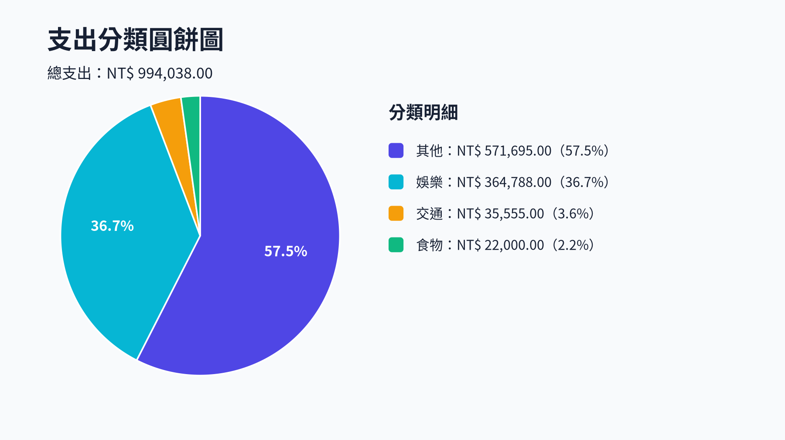

[README.md](https://github.com/user-attachments/files/35128651/README.md)
# Assignment 1 — Version Control Practice
 
**Repository:** https://github.com/ray926213-prog/Assignment

## 1. Project Overview / 專案介紹

本作業以 **Python + SQLite** 實作個人支出管理系統：**A 組員負責輸入與輸出、B 組員負責圓餅圖、C 組員負責額外功能**。系統包含新增、查詢、修改及刪除支出紀錄，並能依分類彙總金額與產生圓餅圖。透過 Git 分支、Commit 與 Merge 練習團隊協作。

This project is a Python and SQLite expense tracker. Member A handles input/output, Member B develops category-based pie-chart visualization, and Member C handles additional features. Git branches and merge commits document collaborative development.

## 2. Team Responsibilities / 分工

| Role | Responsibility | Files |
| --- | --- | --- |
| 1132918 蔡秉叡 | 輸入與輸出（Input / Output）：支出資料輸入、結果顯示及整合協調 | `V3_0.py` 的輸入／輸出流程、`expenses.db` |
| 1132945 陳裕升 | 圓餅圖（Visualization）：讀取 SQLite、分類金額加總、產生圖表 | `pie_chart.py`, `pie_chart.svg`, `pie_chart.png` |
| 1132921 方均祁 | 額外功能（Additional Features）：擴充基本支出管理功能 | 整合於 `V3_0.py`；實際負責功能請組長依提交紀錄確認 |


## 3. Files / 檔案說明

| File | Purpose |
| --- | --- |
| `V3_0.py` | A 與 C 功能的整合主程式：輸入／輸出、額外支出管理功能、功能選單 |
| `pie_chart.py` | Member B's visualization module; uses only the Python standard library |
| `expenses.db` | SQLite database, with table `expenses` |
| `pie_chart.svg` | Category pie chart generated from stored expense data |
| `pie_chart.png` | Screenshot/image of the category chart for the README |
| `README.md` | Setup and run instructions and sample result |

`expenses` schema: `id`, `date`, `amount`, `category`, `notes`.

## 4. Setup / 執行環境

- Windows 10/11 (other systems with Python should also work)
- Python 3.10+; `py` command on Windows
- **No third-party Python packages required**: both SQLite (`sqlite3`) and SVG generation use the Python standard library. There is no need to install NumPy or Matplotlib.
- Git is required only for cloning and version-control practice.

### Download the repository / 下載專案

在 CMD 執行：

```cmd
cd /d "%USERPROFILE%"
git clone https://github.com/ray926213-prog/Assignment.git
cd Assignment
```

若電腦上已有名為 `Assignment` 的資料夾，請改用另一個資料夾名稱，或進入原本的 Git 專案執行 `git pull origin main`；不要覆蓋自己的未提交修改。

### Run the integrated application / 執行整合程式

```cmd
py V3_0.py
```

在選單中輸入 `1` 新增支出、`2` 查詢、`3` 修改、`4` 刪除、`5` 離開。這是整合後提供給使用者的功能，實作分工以本 README 第 2 節為準。程式會使用同資料夾的 `expenses.db` 儲存資料，並在指定操作後更新圓餅圖。

### Generate the chart separately / 單獨產生圓餅圖

```cmd
py pie_chart.py
start pie_chart.svg
```

程式查詢 SQLite 資料表，以 `category` 分組並加總正金額的 `amount`，將圖表輸出到 `pie_chart.svg`。沒有支出資料時，先透過 `py V3_0.py` 新增測試資料。

### Demo without changing the database / 不修改資料庫的示範模式

```cmd
py pie_chart.py --demo
start pie_chart_demo.svg
```

示範模式使用內建範例數據，不會修改 `expenses.db`。

## 5. Example Result / 圖表範例

以下圖片依據已上傳 GitHub 的 `pie_chart.svg` 圖表資料重製為 PNG，用於 README 顯示；圖表金額為該版本的資料快照，不代表之後更新的資料庫金額。



The chart shows the total expenses and each category's amount and percentage.

## 6. Git Collaboration / 版本控制協作

- `main`: integrated application
- `modify`: another contributor's branch; its history was merged into `main`
- `feature-piechart-b`: Member B's visualization branch, containing two commits
- A merge commit on `main` integrates `feature-piechart-b` and preserves its branch history


## 7. Demo Video / 展示影片

**Video link:** https://www.youtube.com/watch?v=a1yCHbpY8sk

Suggested flow: explain roles (A input/output, B pie chart, C additional features); show Git branches and merge history; run `py V3_0.py` to demonstrate A’s input/output and the integrated additional features; run `py pie_chart.py` to open the chart.


